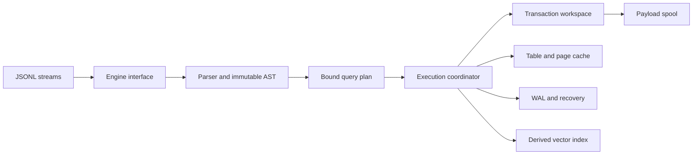

# MiniVectorDB v3

OceanBase 2026 加赛的单机向量数据库。标准接口是 UTF-8 JSONL stdin/stdout，协议见 [STDIO_PROTOCOL.md](STDIO_PROTOCOL.md)。

本分支从已验证候选 f3b13767 重构。原主分支、原候选和未完成重写实验均保留；不自动平台提测。验收按实际 SHA 区分，旧版测试结果不自动算作新版通过。

## 构建与运行

需要 GCC 13+、C++20、GNU make 和 OpenMP；Windows/MSYS2 使用 mingw32-make。产品只依赖标准 C/C++ 和 OpenMP 运行库。

```sh
make -j2
./minivectordb --data-dir=/tmp/mvd-data
```

src/sources.mk 是产品、故障探针和 sanitizer 的统一来源清单；make print-sources 输出完整产品编译清单。链接时优化恢复拆分后的跨模块优化。

```sh
docker build -t minivectordb:latest .
docker run --rm -i -v minivectordb-data:/data --cpus=2 --memory=2g minivectordb:latest
```

基础镜像按摘要固定。拉取基础镜像后，构建不在线安装软件包；运行镜像只复制可执行文件、同一编译镜像的标准运行库及许可。示例资源数值不代表未知正式限额。容器不开放端口，stdout 只输出协议报文；恢复完成后才输出 ready。

## 模块



| 模块 | 职责 |
| --- | --- |
| engine.h | 小型公开 interface，内部状态由独占执行器持有 |
| app/、protocol/ | 参数、流适配、JSON 编解码及恢复与 ready 的顺序 |
| syntax/、sql.cpp | 词法、语法和不携带执行状态的 AST |
| model/、core/ | 值、schema、结果、错误、数值转换、UTF-8、CRC、字节编码 |
| query/plan.* | 扫描前绑定名称、别名、类型和排序键 |
| transaction/workspace.* | 独占行增量、载荷计数、临时文件、语句撤销与自动提交作用域 |
| storage/ | 页、缓存、表、文件 I/O 和 WAL，不拥有向量图或执行器状态 |
| query/ | 可见性、排序、精确距离、向量索引和派生缓存 |
| runtime/ | DDL、修改、提交发布、恢复及明确的生命周期 |

部分根目录头文件保留为兼容入口。已验证的数值和自研 ANN 算法继续使用；数值测试不再通过包含整个 engine.cpp 获取内部类型。

## SQL 与持久化

支持 BIGINT、VARCHAR(n)、VECTOR(n)、单 BIGINT 主键、每表最多一向量列；支持多行 INSERT、投影、比较和 AND、排序、LIMIT/OFFSET、UPDATE/DELETE、事务及 CREATE VECTOR INDEX。

```sql
CREATE TABLE docs(id BIGINT PRIMARY KEY,category VARCHAR(32),v VECTOR(2));
INSERT INTO docs VALUES(1,'db','[1,0]');
SELECT id,L2_DISTANCE(v,'[0,0]') AS d FROM docs ORDER BY d LIMIT 10;
BEGIN;
UPDATE docs SET category='new' WHERE id=1;
ROLLBACK;
```

VARCHAR 长度按 Unicode 码点计，比较按 UTF-8 字节顺序。向量存储为有限 float32，拒绝维度错误、NaN/Infinity 和转换溢出。

精确距离对存储后的 float32 作精确 dyadic 平方和累加，舍入到 float64 后开方；SQL 标量与排序共用结果，等距按有符号主键升序。近似模式可使用自研 HNSW，过滤和事务可见性不能放宽。缺省 exact，模式由请求参数指定。

磁盘格式保持兼容：64 KiB 页、表目录、完整页镜像 WAL 和提交记录。提交成功确认前同步 WAL；发布中断进入恢复屏障，恢复一致状态后才处理后续请求。事务临时载荷与查询外排不是恢复依据。

## 检查入口

```sh
python tests/audit_suite.py --output protocol-results/local-audit
python tests/refactor_contracts.py --output protocol-results/module-contracts.json
python tests/state_machine_model.py --wide-spill --steps 1200 --output protocol-results/wide-model.json
```

覆盖 JSONL 握手/公开用例、独立语义与数值模型、已有故障反例、强杀及重复恢复。新接口检查包括 I/O 错误后的载荷和计数一致性、嵌套语句、自动提交、同对象重开、协议顺序、schema 与绑定验证。ASAN/UBSAN、锁定 Docker、超内存数据和大事务由 GitHub Actions 验证。每项按完成产物判断，未执行的不计为通过。

SQL/TSV 辅助回归不代替正式 JSONL。自测 T/B/M 是同机对照，不是官方成绩；I/O 按实际数据文件系统及经验证的分区关系识别，保留原始计数，缺失采集不算零成本。

## 当前限制

- 定长记录支持跨页，沿用仓库主人 c7e340bc 的分页映射；单条记录工作缓冲区上限为 16 MiB。
- 主键、事务元数据和最终结果集内存随规模增长，载荷落盘不代表所有内存恒定。
- 正式失败 SQL、完整冻结参数范围与极端参考浮点计算顺序仍未知。
- 有限审查和测试不证明全部 bug 已排除，也不保证正式准入或分数。

重构与验收见 [REFACTOR_V3.md](REFACTOR_V3.md)。Agent 材料保留真实对话，不伪造学生解释、工具结果或学习证据。
